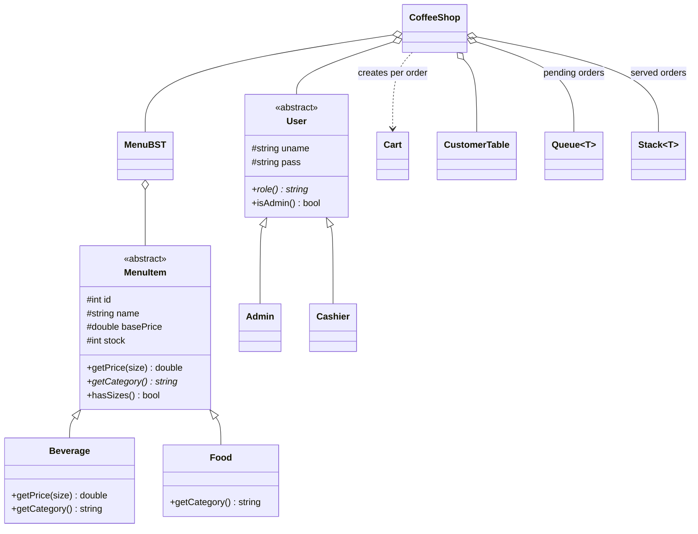

# ☕ Coffee Shop Management System

A console-based **Coffee Shop Management System** written in **C++**, built to demonstrate **Object-Oriented Programming (OOP)** and **Data Structures & Algorithms (DSA)** in a real-world scenario.

It handles menu management, order taking, kitchen queue, billing with receipts, customer loyalty points, stock tracking and sales reports, with role-based login (Admin / Cashier) and file-based data storage.

---

## 📌 Table of Contents
- [Features](#-features)
- [Concepts Used](#-concepts-used)
- [Class Diagram](#-class-diagram)
- [Project Structure](#-project-structure)
- [Getting Started](#-getting-started)
- [How to Use](#-how-to-use)
- [Data Files](#-data-files)
- [Sample Receipt](#-sample-receipt)
- [Future Improvements](#-future-improvements)
- [Author](#-author)

---

## ✨ Features

| Module | Description |
|---|---|
| 🔐 Login | Role-based access: **Admin** and **Cashier** |
| 📋 Menu | View, search by ID, sort by name / price / stock |
| 🛒 Orders | Add items, choose size (S/M/L), undo last add, checkout |
| 🧾 Billing | Auto-calculated subtotal, discount, total, change and receipt |
| 👨‍🍳 Kitchen Queue | Orders are served in FIFO order |
| 📜 Order History | Recently served orders (latest first) |
| 🎁 Loyalty | 1 point per Rs 100 spent; redeem 50 points for Rs 100 off |
| 📦 Stock | Auto stock deduction, out-of-stock check, low-stock alert |
| 📊 Reports | Total orders, total revenue, pending and served counts |
| 🛠 Admin Tools | Add, update (price/stock) and remove menu items |
| 💾 Persistence | Data saved in text files, so it is kept between runs |

---

## 🧠 Concepts Used

### OOP

| Concept | Where it is used |
|---|---|
| **Abstraction** | `MenuItem` and `User` are abstract base classes |
| **Inheritance** | `Beverage`, `Food` → `MenuItem`; `Admin`, `Cashier` → `User` |
| **Polymorphism** | Virtual `getPrice()`, `getCategory()`, `role()`, `isAdmin()` |
| **Encapsulation** | Protected data members with public getters/setters |
| **Templates** | Generic `Queue<T>` and `Stack<T>` classes |

### Data Structures & Algorithms

| DSA | Used for | Complexity |
|---|---|---|
| **Binary Search Tree** | Menu storage, search / insert / delete by item ID | O(log n) average |
| **Singly Linked List** | Shopping cart | O(n) |
| **Queue** (linked list) | Pending orders (kitchen), FIFO | O(1) push/pop |
| **Stack** (linked list) | Undo cart action, served-order history, LIFO | O(1) push/pop |
| **Hash Table** (chaining) | Customer lookup by phone number | O(1) average |
| **Merge Sort** | Sorting menu by name, price or stock | O(n log n) |
| **Inorder Traversal** | Display menu in sorted ID order | O(n) |

---

## 🗺 Class Diagram



---

## 📁 Project Structure

```
coffee-shop-management-system/
├── CoffeeShop.cpp     # Complete source code
├── README.md          # Documentation
├── .gitignore         # Ignores compiled binary & generated data files
│
│  (auto-generated when you run the program)
├── menu.txt           # Menu items
├── customers.txt      # Customer loyalty data
└── sales.txt          # Sales log
```

---

## 🚀 Getting Started

### Requirements
- A C++ compiler with C++11 support (g++, clang++, MinGW or MSVC)

### Compile and Run

**Linux / macOS / MinGW**
```bash
g++ -std=c++11 CoffeeShop.cpp -o coffeeshop
./coffeeshop
```

**Windows (MinGW, Command Prompt)**
```bat
g++ -std=c++11 CoffeeShop.cpp -o coffeeshop.exe
coffeeshop.exe
```

### Default Logins

| Role | Username | Password |
|---|---|---|
| Admin | `admin` | `admin123` |
| Cashier | `cashier` | `cash123` |

> ⚠️ Credentials are hard-coded for learning purposes only.

---

## 🖥 How to Use

### Main Menu
```
 1) View menu          2) Search item by ID
 3) Sort menu          4) New order
 5) Serve next order   6) View pending queue
 7) Served orders      8) Customer loyalty lookup
 9) Sales report
10) Add menu item     11) Update price/stock     (Admin only)
12) Remove menu item                             (Admin only)
 0) Logout
```

### Taking an Order
1. Choose **4) New order**
2. **Add item**: enter item ID, size (for beverages) and quantity
3. Use **Undo** to remove the last added item (Stack)
4. **Checkout**: enter customer phone (optional), redeem points if available, enter cash received
5. The receipt is printed and the order goes to the **kitchen queue**
6. Use **5) Serve next order** to serve orders in the order they came in

### Pricing
- Beverages: base price is **Medium**; **Small = −20%**, **Large = +25%**
- Food items have a fixed price

### Loyalty Program
- Earn **1 point per Rs 100** spent
- Redeem **50 points = Rs 100 discount**

---

## 💾 Data Files

Plain text, `|` separated:

| File | Format |
|---|---|
| `menu.txt` | `Type\|ID\|Name\|Price\|Stock` e.g. `B\|102\|Cappuccino\|350\|50` |
| `customers.txt` | `Phone\|Name\|Points` |
| `sales.txt` | `OrderNo\|Customer\|Total\|DateTime` |

If `menu.txt` does not exist, the program creates a default menu on first run.

---

## 🧾 Sample Receipt

```
==========================================
          COFFEE SHOP - RECEIPT
==========================================
 Order #1001   2026-10-11 12:24
 Customer: Moiz   Cashier: admin
------------------------------------------
 Cappuccino (M)          x2          700
------------------------------------------
 Subtotal                            700
 TOTAL                               700
 Paid                               2000
 Change                             1300
==========================================
        Thank you! Visit again :)
```

---

## 🔮 Future Improvements
- Split code into multiple files (headers + source)
- Password hashing and user management
- Daily / monthly sales analytics and best-seller report
- Table-wise ordering and tax/service charges
- GUI version (Qt) or web version (React + Node.js)
- Database support (SQLite / MongoDB)

---

## 👤 Author

**Malik Moiz Ahmad Awan**
BS Computer Science, University of Gujrat

---

## 📄 License

This project is for educational purposes. Free to use and modify.
